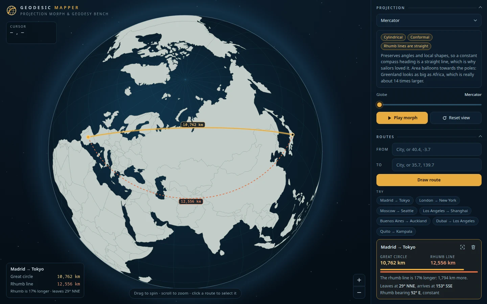
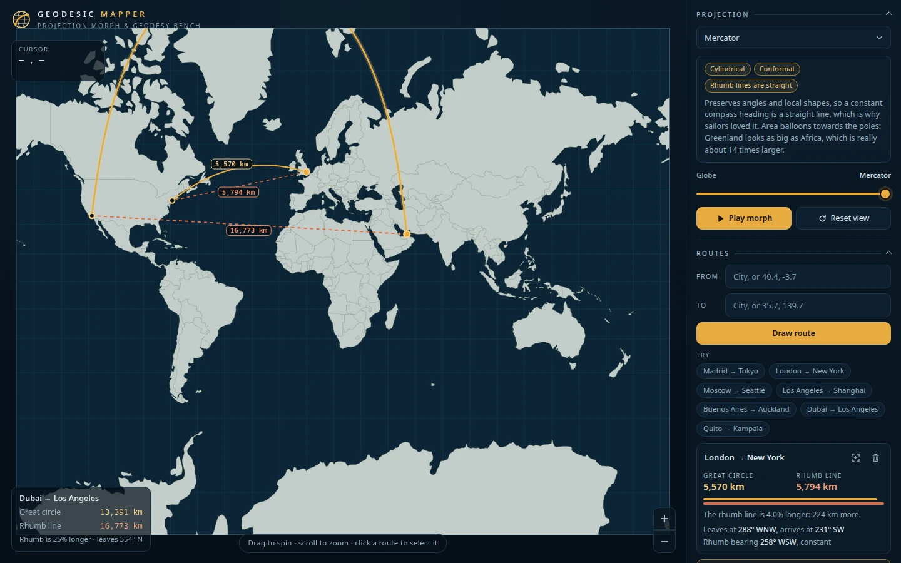
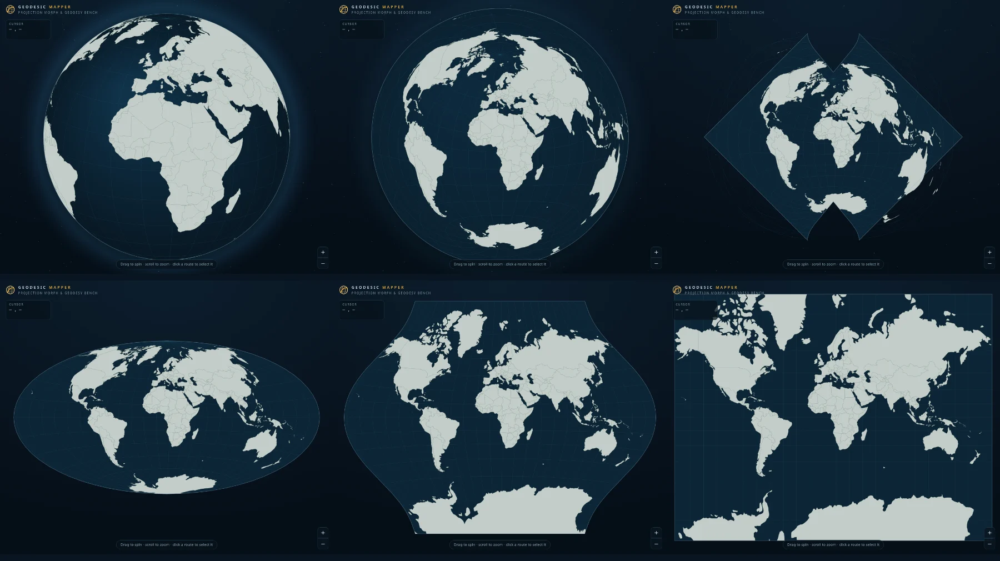

# Geodesic Mapper

**Morph a globe into a flat map, and see why the shortest way between two places rarely looks straight.**

Geodesic Mapper turns the globe into any of 14 map projections with a smooth animation, and draws two
paths between the places you pick: the **great circle** (the shortest path on a sphere) and the
**rhumb line** (the path of constant compass bearing). Distances and bearings are live, and the
difference between the two paths is the whole point: on a Mercator map the rhumb line is the straight
one and the shortest route is the curve; on a gnomonic map it is the other way round.



It is a static site: no server, no accounts, no tracking, and nothing is fetched from anywhere but its own
host (no map tiles, no CDN, no API), so it also runs from a local file server with the network off.

## What you can do

- **Morph** between the globe and 14 projections with a slider or the Play button. Changing the map
  while flat folds the old one up and unfolds the new one, so you can watch what each projection does.
- **Compare two paths** between any two places. Pick them by name (a built-in gazetteer of about 1,250
  cities), by typed coordinates (`40.4168, -3.7038`, `40.4N 3.7W`, `40°26′46″N 79°58′56″W`), or by
  clicking the map. Try one of the seven example routes to see a path that crosses the pole, one
  that crosses the antimeridian, and one where both lines coincide.
- **Read the numbers**: great-circle and rhumb distance in km, miles or nautical miles; the initial,
  final and constant bearings with compass names; per-leg figures for multi-point routes; and how
  much longer the rhumb line is.
- **Learn from the projection**: each map carries a short, plain note on what it preserves and what it
  gives up. Switch on the **Tissot indicatrix** to see the distortion directly, **Day and night** to see
  where the Sun is right now, and **Key parallels** for the equator, tropics and polar circles.
- **Share it**: the address bar always holds the view, the morph position and every route, so copying
  the link reproduces what you see. Save the map as an image, or export and import routes as GeoJSON.



## How the morph works

A globe cannot be flattened without tearing it, so the morph is built from four stages:

```
globe (orthographic) → whole world as a disc → the disc opened into an oval → target map
```



Between stages the raw projection formulas are blended point by point. While the globe unrolls, a
computed *horizon* limits the picture to the part of the sphere that has not yet folded back on itself,
which is what stops the far side of the Earth from ghosting through the near side. Azimuthal maps share
the globe's geometry, so they are reached directly. Clicks and the cursor readout stay correct during the
morph: blends that unroll the globe are inverted exactly, and the rest with Newton's method.

Three details keep the motion natural:

* **The disc opens through a family, not a blend.** Aitoff is the azimuthal equidistant map with the
  longitudes halved and x doubled, so the morph lets that halving go from 1 to ½ and the world's outline
  stays rounded all the way. (A straight blend of the two turned the rim into a diamond with notches.)
* **Even pace.** Equal steps of the slider do not look equally fast: opening the disc is a fifth of the
  slider and most of the change. The engine measures how far the picture travels on screen
  (`Engine.progress`), and both the slider and *Play morph* move by that, with a short run-up and
  run-down, so no stage rushes past. *Play morph* rests a moment at each end.
* **Maps turn into each other.** Changing the projection on a flat map blends the old map into the new
  one in place (about 0.7 s) instead of folding the world back to the globe. Going between a flat map
  and an azimuthal one still passes through the globe, but in one motion that is slow at the start, at the
  globe and at the end.

## Controls

| | Mouse and trackpad | Touch | Keyboard |
| --- | --- | --- | --- |
| Turn the globe, slide a flat map | drag (in every tool) | drag | arrow keys (`Shift` for bigger steps) |
| Zoom | wheel, or the + / − buttons | pinch | `+` and `−` |
| Measure a route | click points, double-click to finish | tap points, use the **Finish** button | `M`, then `Enter` to finish, `Esc` to cancel |
| Undo the last point | right-click | **Undo** button | `Backspace` or `Ctrl+Z` |
| Drop a marker / cut a route | `P` tool / `X` tool, then click | the tool buttons | `P`, `X` |
| Play or pause the morph | Play button | Play button | `Space` |
| Previous or next projection | the menu | the menu | `[` and `]` |
| Reset the view | Reset view | Reset view | `R` |

Dragging always moves the view; a click that barely moves does the active tool's job. Press `?` in the
app for the shortcut list.

## Projections

| Projection | Family | It keeps | It gives up |
| --- | --- | --- | --- |
| Stereographic | Azimuthal | angles; circles stay circles | area balloons away from the centre |
| Gnomonic | Azimuthal | great circles are straight lines | shows under a hemisphere; extreme edge distortion |
| Azimuthal equal-area | Azimuthal | area | shapes bend towards the edge |
| Azimuthal equidistant | Azimuthal | true distance and direction from the centre | area and shape far from the centre |
| Equirectangular | Cylindrical | a simple latitude/longitude grid | shape and area |
| Mercator | Cylindrical | angles; rhumb lines are straight | area grows towards the poles |
| Natural Earth | Compromise | a balanced look | neither conformal nor equal-area |
| Equal Earth | Compromise | area | a little shape |
| Robinson | Compromise | a natural look | neither conformal nor equal-area |
| Winkel Tripel | Compromise | low overall error | exactness of any single property |
| Mollweide | Compromise | area | shapes squash near the edges |
| Eckert IV | Compromise | area | shapes shear near the edges |
| Sinusoidal | Compromise | area; true scale along parallels | heavy shear near the edges |
| Aitoff | Compromise | a compact whole-world oval | area and angles |

## Run it

You need Node.js 20.19 or newer (22 recommended).

```bash
npm install
npm run dev        # http://localhost:5173 with hot reload
```

```bash
npm run build      # a static site in dist/ (about 80 kB of script to first paint)
npm run preview    # serve dist/ at http://localhost:4173
```

Do not open `dist/index.html` by double-clicking: browsers block module scripts over `file://`. Use
`npm run preview` or any static file server. The build uses relative paths, so it works from any folder
or sub-path.

## Test it

| Command | What it checks |
| --- | --- |
| `npm test` | Unit tests: spherical geodesy, sun position, coordinate parsing, the projection engine (including that every visible point can be picked back from the screen at every morph stage), place search, GeoJSON, shared-link state. |
| `npm run lint` | ESLint. |
| `npm run smoke` | Drives the production build in a real browser: every projection and morph position draws, the tools, search, drag, pinch, file export and import, and shared links all work, and nothing logs an error. Needs a Chromium-family browser (`CHROME_PATH` if it is in an unusual place) and `npm run build` first. |
| `npm run screenshots` | Regenerates the pictures in `docs/`. |

## Project layout

```
index.html              page structure; the panel's static markup lives here
src/main.js             wires the app together
src/app/                state, the App class (every action), shared-link encoding
src/geo/                geodesy, projections (the morph engine), world data, places, GeoJSON, hit testing
src/render/             canvas drawing: ocean, grid, land, overlays, routes, labels, star field
src/ui/                 panel, overlays, pointer and keyboard input, autocomplete
src/data/               the place gazetteer and the example routes
scripts/                build-places, smoke test, screenshots
tests/                  Vitest unit tests
```

The place list is built from Natural Earth by `scripts/build-places.mjs`; run it again to refresh
`src/data/places.json`.

## Deploying

The output of `npm run build` is plain static files; put `dist/` on any static host. For GitHub Pages,
turn on Pages with "GitHub Actions" as the source in the repository settings and run the **Deploy to
GitHub Pages** workflow from the Actions tab. Pushes and pull requests run the **CI** workflow (lint,
tests, build and the smoke test).

## Good to know

- **The Earth is treated as a sphere** with a mean radius of 6,371.0088 km. Distances are within about
  0.5 % of the true (ellipsoidal) value, which is more than enough to compare the two paths.
- **Mid-morph picking** can be ambiguous in a narrow band along the antimeridian, where a blend of two
  projections briefly folds over itself; the app picks the position that lands on the pixel you pointed at.
- **Mercator is cropped at 80° latitude** because its poles are infinitely far away. A route that climbs
  higher than that (try *Dubai → Los Angeles*) leaves the top of the map, which is the lesson.

## Credits

- Coastlines and borders: [Natural Earth](https://www.naturalearthdata.com/) (public domain) through
  [`world-atlas`](https://github.com/topojson/world-atlas) (ISC); places: Natural Earth populated places.
- Projections and geometry: [D3](https://d3js.org/) (`d3-geo`, `d3-geo-projection`), TopoJSON.
- Sun position: the low-precision formulae of the Astronomical Almanac.
