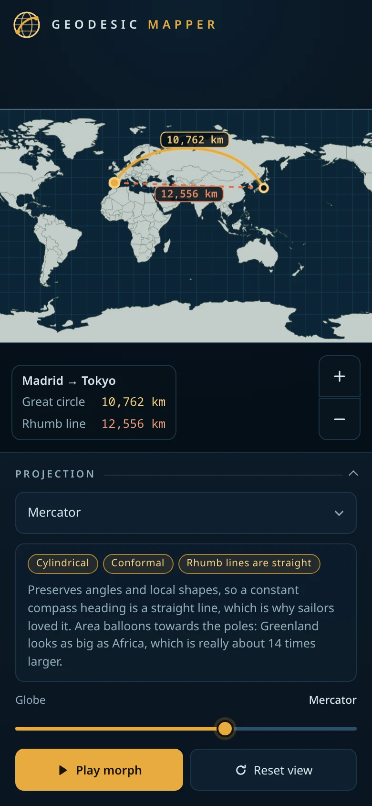

<div align="center">


# Geodesic Mapper

**Turn a globe into a flat map, and see why the shortest way between two places rarely looks straight.**<br>
Fourteen map projections, two kinds of path, nothing to install.


</div>

## What it is

On a globe the shortest route between two places is a great circle. On most flat maps that route is a curve, and the straight line is a different path: the one with a constant compass bearing, the rhumb line. Geodesic Mapper draws both between the places you pick, with live distances and bearings, and lets you turn the globe into any of 14 projections to watch the two paths change places.

It is a static site: no server, no account, no tracking, and nothing loaded from anywhere else, so it works with the network off too.

## What it does

### Turns the globe into a map

Press Play or drag the slider and the globe unrolls like a sheet of paper, then takes the shape of the projection you chose: Mercator, Robinson, Winkel Tripel, Mollweide, Gnomonic and nine more. Each one comes with a short note on what it keeps and what it gives up, and the Tissot circles show its distortion directly.


### Compares the two paths

Choose two places by name (about 1,250 cities are built in), by coordinates, or by clicking the map. You get the great-circle and rhumb-line distances in km, miles or nautical miles, the bearings, and how much longer the rhumb line is. Seven example routes include one over the pole and one across the antimeridian.


### Works on a phone

Drag to turn the globe or slide the map, pinch to zoom, tap to measure.



### Shares what you see

The address always holds the view, the morph position and every route, so copying the link reproduces it. Save the map as an image, or export and import routes as GeoJSON.

## Run it yourself

```sh
npm install
npm run dev
```

It needs Node 20.19 or newer. `npm run build` makes a static site in `dist/` that works from any folder, and `npm test` runs the tests.

## Credits

Coastlines and borders come from [Natural Earth](https://www.naturalearthdata.com/) (public domain) through [`world-atlas`](https://github.com/topojson/world-atlas), the projections from [D3](https://d3js.org/), and the Sun's position from the Astronomical Almanac's formulae.

## License

[MIT](LICENSE). The map data keeps its own terms (see Credits).
